<picture>
  <source media="(prefers-color-scheme: dark)" srcset="./assets/header-dark.svg">
  
</picture>

Trabalho na logística de uma cooperativa agroindustrial de grande porte. Monto painéis, pipelines de dados e automações para expedição, armazenagem, frete e exportação.

Começo indo até quem opera o processo para ver onde ele trava. Só considero pronto depois de medir o resultado contra dado real.

### Resultados no trabalho atual

| Problema | O que construí | Resultado |
|---|---|---|
| Conferência de estoque manual em mais de 10 armazéns, cada um com planilha num layout diferente | Conciliação automática ERP × armazéns que entende cada formato e trava se um arquivo vier com erro | De 2 conferências manuais por dia para 1 automática por hora |
| Conferência de documentos de exportação campo a campo | Cruzamento de invoice, packing list e certificados que mostra ao analista só o campo que diverge | 97,5% de precisão contra um gabarito de 24 dossiês conferidos à mão |
| Canhotos de entrega conferidos um a um | Leitura do número da nota e checagem de assinatura por visão computacional | Em 158 páginas reais, a conferência manual caiu de 156 para 52 canhotos |
| Lotes de faturamento de 20 a 40 notas parados à espera de alguém acompanhar | Robô reconstruído para rodar do início ao fim tratando os próprios erros | Lote fecha sem acompanhamento |

Esses sistemas pertencem à empresa e não estão aqui. Os repositórios abaixo são projetos meus ou estudos de caso refeitos do zero com dados sintéticos.

### Projetos

| Projeto | Descrição | Stack |
|---|---|---|
| [expedicao-whatsapp](https://github.com/qfield404/expedicao-whatsapp) | Bot de WhatsApp que avisa o motorista quando a placa é liberada na expedição. Tem painel de operação, painel administrativo, histórico de conversas e IA que pode ser desligada por contato. | Node.js · SQLite · Gemini |

### Ferramentas

**Dados e BI:** Power BI, DAX, Power Query, Microsoft Fabric, SQL 
**Programação:** Python, TypeScript e Node.js, VBA, Git 
**IA aplicada:** OCR, visão computacional (YOLO, reconhecimento facial), extração de dados de documentos com precisão medida

### Formação

Análise e Desenvolvimento de Sistemas na PUCPR (em andamento) e Técnico em Informática pelo IFPR.
